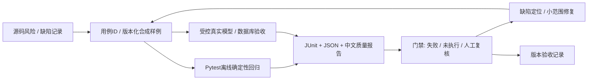

# OpsDesk AI Evaluation Suite 建设方案

日期：2026-10-13。基于[本轮源码审计](OPSDesk_QA_AUDIT.md)及提交 `925185f7238595733b115b0239ede8d669b37bb4`。

**本文是 Phase 2 设计，尚未实施。** 本轮未添加永久测试Suite、CI、新依赖或业务功能。文件名、任务、阈值及验收方式均为建议；后续成果只按实际执行及缺陷闭环记录汇报。

## 1. 目标与总体方案

建立从需求风险、用例与数据、自动执行、问题定位、修复回归到版本质量报告的本地闭环。项目仍为IT服务台原型；不增加银行业务功能，也不将本地测试当作银行生产测试。

默认运行确定性、无网络、临时SQL的快速回归；真实模型、真实数据库、部署和性能任务分开执行。复用现有Pytest、httpx/TestClient、模型替身、MCP SDK和两个脚本，先解决已证实的测试盲点。



门禁必须区分passed、failed、skipped和not_run/blocked；真模型未运行时，离线通过不能代替真模型通过。设计失败用例使门禁实际失败，防止只有报告文件却永远返回成功。

## 2. 七类质量模块

| 模块 | 首批检查 | 复用资产 / 执行环境 | 断言性质 |
| --- | --- | --- | --- |
| API Test Suite | 输入边界、角色/归属、会话失效、版本冲突、失败状态与SSE顺序 | TestClient、runtime；临时SQLite | status/schema/状态/事件的确定性断言 |
| RAG Evaluation | 分词、BM25、融合、重排、未知ID、无结果、知识更新 | KnowledgeIndex、12查询；向量替身；真实混合检索另跑 | 金标检索排名可确定计算；回答正确性需人工/AI评审 |
| Agent Workflow | 依赖、失败取消、重复节点、角色调用、动作选择 | TaskGraph、ServiceTeam、ScriptedModel与spy | 四角色及工具次数/参数/依赖为确定性；最终实用性另评 |
| Security Testing | 两员工隔离、Cookie过期、工具eligibility、注入、危险答复、导出公式 | 现有安全用例；恶意文本/模型输出均为合成输入 | 固定危险样例与权限断言确定性；真实LLM注入抵抗需独立评测 |
| Reliability Testing | chat超时/坏JSON、Redis故障、陈旧索引、MCP异常、worker退出/饥饿 | monkeypatch/MockTransport、临时SQL、隔离真实MCP | 状态、降级标志、恢复、副作用次数与审计为确定性 |
| Performance Testing | 提交/答复/工具完成分别计时，低并发、积压、错误率 | 先用httpx+monotonic；专用测试实例 | 计量方法确定，数值依硬件/模型/样本变化 |
| QA Reporting | 汇总分母、环境、失败样例、已知缺陷、未运行任务、版本比较 | Pytest JUnit、evaluate/live JSON；轻量解析脚本 | 报告完整性与失败退出可确定测试 |

不优先重构角色闭包：通过团队注入对象/spy即可覆盖大部分分支。只有被具体测试阻塞的边界，才在另行授权后提取小接口；避免为架构美观改写业务流程。

## 3. 推荐资产与数据规则

### 3.1 建议目录（本轮未创建）

```text
tests/qa/
  conftest.py                   # 增补第二员工、模型/缓存/向量替身
  test_security_regressions.py  # 拒绝策略与导出公式
  test_queue_recovery.py        # 存活、租约、饥饿与完整恢复
  test_rag_regression.py        # 固定查询与索引负例
  test_api_contracts.py         # 输入、归属与状态边界
  test_model_failures.py        # HTTP/schema异常及回退
  test_report_gate.py           # 报告与退出码
evaluation/qa/
  retrieval_cases.jsonl
  safety_cases.jsonl
  workflow_cases.jsonl
scripts/qa/
  run_checks.py                # 隔离、环境检查、超时、统一结果
  build_report.py              # JUnit/eval/缺陷摘要
docs/qa/defects/
  QA-SEC-01.md                  # 实际修复时建立逐项闭环记录
requirements-dev.in            # 少量测试依赖，与运行依赖分开
.github/workflows/qa.yml        # 本地门禁稳定后再接入
```

最终用例数量由风险覆盖决定，不能先定“100项”再补同义样例。保留现有20个有意义的用例；新样例需指明新增行为或边界。

### 3.2 数据与版本

每条样例建议包含：`case_id`、`suite`、`scenario`、`language`、`origin`（合成/人工标注）、`query`、`expected_intent`、`expected_priority`、`expected_sources`、`expected_behavior`、`allowed_actions`、`risk_tags`。不适用字段明确为空；无答案样例的expected_sources为空，期望是补充信息/谨慎回退，不能伪造文档。

用不同字段区分：分类服务场景、问题主题、执行profile和是否需真实模型。现有24条只验证规则，12条只验证检索，不能合并为36条模型测试。

先将现有样例标为baseline/regression；另由人工确认无答案、否定/引用故障、team范围、混合意图、中英文歧义、过期知识、恶意知识指令等边界。新的保留样例不能在反复改规则时同时当作独立泛化集。全部使用虚构IT文档和合成请求，禁止导入银行内部数据。

报告保存Git SHA、样例/知识/Skills/prompt哈希、Python/依赖版本、运行profile、模型与embedding digest（真环境才有）、温度等安全配置、执行时间、结果分母。实际DSN、密码、bearer、Cookie、SMTP个人地址不进入报告。

### 3.3 指标与质量判定

| 指标 | 定义与用途 | 不能推导的结论 |
| --- | --- | --- |
| 规则匹配正确数/样例数 | 原分类规则的回归；逐类列出混淆与失败样例 | 不等于LLM准确率或真实用户效果 |
| document HitRate@k、MRR | 对expected_sources计算文档排名；声明k、聚合与重复片段去重口径 | 小合成集100%不等于生产检索可靠率 |
| 无答案/负例行为 | 空库或无依据时不编造依据；先人工确认期望，再给确定性契约 | 邻居向量非空不等于找到答案 |
| 引用一致性 | 返回source/segment能对应本次有效语料，回答中引用在允许集合 | 不等于回答中的每个事实都受证据支持 |
| 角色/动作契约 | 依赖、角色次数、工具参数、FAQ无动作、P1升级、幂等次数 | 不等于模型自主工具规划能力 |
| 降级与恢复 | timeout/error后的状态、fallback/dead/retry、worker存活、无重复副作用 | Mock通过不等于真实断网恢复已验收 |
| 答案质量 | 依据充分、事实支持、可操作性、与问题相关、安全；人工逐项判定 | 不用“字符串等于参考答案”衡量开放式生成 |
| 延迟/吞吐/失败率 | 分别测提交确认、审查后答复、工具完成、队列等待；记录n及配置 | POST快不等于答复快；不能用demo值推真实模型性能 |

确定性安全契约做阻断门禁；开放答案先人工标注与抽样复核。后续LLM-as-judge必须校准中文与IT语境、记录模型/提示及理由，保留分歧，不把自评作为唯一安全门禁。温度0仍需重复试验；样本不足时只报原始值与范围，不发布稳定P99或泛化提升。

## 4. P0：首先建立可失败、可定位的离线闭环

工作量等级：S表示局部文件/少量确定性用例，M表示跨边界或多个故障路径；不是已完成工时或承诺排期。

| 任务 | 涉及位置 | 预计资产及价值 | 工作量 |
| --- | --- | --- | --- |
| P0-1 缺陷复现→修复→回归 | `orchestration.py:final_text_check/review`、`actions.py:export_ledger`、`queueing.py:claim/run/step`、`retrieval.py:search` | 将QA-SEC-01/02、QA-REL-01/02、QA-RAG-01转为正式失败回归；每项有触发输入、修复提交、前后结果及独立断言 | M，按缺陷拆分 |
| P0-2 独立RAG与固定样例门禁 | `retrieval.py:terms/lexical/search`、`evaluation/cases.json`、`scripts/evaluate.py` | 现有12查询参数化；分词、空库/无匹配、融合排序、标题规则重排、坏vector ID；24规则复用；指标不达标非零退出，解决QA-GATE-01 | M |
| P0-3 API/权限与模型失败矩阵 | `contracts.py`、`identity.py`、`main.py`、`inference.py`、`ServiceTeam.solve` | 两员工操作/thread/ticket/SSE/MCP隔离；会话过期/撤销；消息/key/revision边界；chat超时、非2xx、schema坏JSON、各角色fallback；无数据库副作用的权限负例 | M |
| P0-4 统一隔离执行与报告 | `tests/conftest.py`、`pyproject.toml`、两个现有脚本、拟建scripts/qa | 一条本地命令执行离线用例与必要的demo MCP验收；JUnit+JSON+Markdown、profile分类、未运行清单、缺陷关联；获得首次行/分支覆盖率基线 | S/M |
| P0-5 基础自动执行 | 拟建`.github/workflows/qa.yml`、测试开发依赖 | 本地流程稳定后接CI；默认不下载模型、不调用远程judge、不接真实业务库；失败阻断与报告保留 | S，发布需用户确认 |

**复用方式**：现有fixture/策略测试/图调度/去重/台账/租约/版本冲突继续保留。按接口拆分综合用例可在新增边界时逐步做，不先全量搬迁。真实stdio可继续由隔离verify_live脚本验证，不要用direct成功冒充协议成功。

**修复边界**：Phase 2才允许业务改动。围绕缺陷做最小修补，不弱化安全检查、不修改gold label迎合结果。未知向量ID的回退、worker异常恢复和候选选择需兼顾既有行为；“review不可用是否允许原草稿发布”是需要确认的策略，建议采用安全通用答复并显式标记降级。

**P0验收标准：**

1. 默认执行不依赖Ollama/Redis/MySQL，不读取实际.env，不写原有var；原20用例与新增用例可在同一干净环境重现。
2. 以上5项行为风险具有正式回归，修复前能观察失败，修复后通过；所有修复关联到缺陷ID与提交。若暂缓修复，记录开放且阻断相应发布结论，不将xfail/skip作为修复证据。
3. RAG/规则报告显示数据版本、分母和检索模式；故意破坏一条金标时测试或门禁确实非零退出。
4. API拒绝路径无新增工单/台账；模型异常有可解释结果；worker故障/积压场景验证最终可继续执行，而非只检查一个字段。
5. 获得真实coverage报告，列出重点模块未覆盖分支；先建立基线，不拍脑袋设80%或100%。覆盖率不能替代上述行为断言。
6. 本地报告同时列出通过、失败、跳过及未执行的真实环境任务；安全和可靠性负例具备失败案例详情。
7. CI如启用，至少保留一次全绿和一次刻意失败的执行证据；远程服务/资料传输须另经授权。

## 5. P1：真实环境、运行处置与版本验收

| 任务 | 代码位置/复用 | 新增资产与验收标准 |
| --- | --- | --- |
| 真实MySQL/Redis集成 | `storage.py`行锁/唯一约束、`history.py`、队列 | 单独Compose测试项目、专用库/卷；两连接真实竞态、revision冲突、Redis断连/坏值/恢复、事务失败无半成品。明确区分SQLite与MySQL结果 |
| 真模型与混合检索 | `InferenceGateway`、KnowledgeIndex、ServiceTeam、`verify_live.py --require-real` | 有界金标集、模型digest/知识哈希、各角色真实错误/降级记录；复测需LLM成功及vector使用，不能悄悄回退demo。报告意图/优先级与答案质量分别计算 |
| 注入与引用质量 | 系统prompt、Skills、导入文档、review输出 | 用户输入/知识/历史三个注入来源；人工确认标准；记录攻击成功/失败/不确定与具体样例，不宣称完全防御 |
| 异常处置与人工恢复审计 | `retry`、ActionHistory、diagnostics、lifespan | 补QA-OBS-01：操作者、原因、关联job、时间与结果；worker存活/错误/积压可观察，演练发现→处置→恢复并留证 |
| 部署与发布验收 | Dockerfile/compose、健康/就绪与配置 | 测试镜像、独立数据、启动/依赖不可用/重启验证；保留版本与配置摘要。回滚只能在专用测试实例演练，不自动触及原有卷 |
| 小并发性能基线 | 提交、SSE、operation状态、queue与模型耗时 | httpx先做少量受控并发；区分冷/热、FAQ/P2/P1、demo/real；等待答复和动作完成，记录实际n、硬件、失败及积压；不把SSE缓冲时间叫首token |

建议新增registered markers：`real_model`、`real_db`、`mcp_stdio`、`performance`。环境缺失时真实任务标blocked/not_run并说明原因；默认离线green不表示整套全绿。保留现有单API进程约束，不为跑压力测试直接启动多个worker。

**P1验收：** 同一Git/数据版本的离线、真数据库、真模型结果可以关联；成功与故障路径均有记录；恢复完成要检查副作用与状态一致性；性能方法可重跑，指标阈值在建立基线和明确机器预算后再定。

## 6. P2：必要时再扩展

1. 选择一个语义评测框架，接入人工校准的答案依据/相关性指标；避免同时引入Ragas与DeepEval。
2. 若需要持续用户负载、可视化吞吐和调度控制，引入Locust；SSE与异步处理必须自定义业务完成计量，不能只看提交接口HTTP耗时。
3. 稳定版本再做更长的soak、异常风暴和限流需求验证；每次明确负载和终止条件，只作用于专用实例。
4. 如确有多进程需求，再设计持久化请求任务、跨进程锁与启动恢复范围；这是架构变更，不是当前Phase 1成果。
5. 更高级的Tracing/指标平台、属性测试或变异测试，仅用于已有具体盲点，避免先建平台后寻找问题。

**P2验收：** 能证明新增工具解决了P0/P1无法经济覆盖的问题；维护成本、可复现配置、数据传输、人工校准与失败处置均有说明。P2未做不影响第一版离线Suite交付。

## 7. 技术选型：收益与维护成本

以下工具能力依据2026-10-13核对的官方文档；版本与接口在实施前再次确认。本轮未安装这些新工具。

| 选择 | 建议 | 原因与成本 |
| --- | --- | --- |
| Pytest + TestClient/httpx + 内置asyncio | P0沿用 | 已有可运行fixture和SDK，直接表达业务断言；暂不需要pytest-asyncio，若需要跨用例异步fixture再评估 |
| coverage/pytest-cov | P0少量开发依赖 | 解决当前覆盖率未知，提供行/分支缺口；单独记录测试配置与排除项，不将报告百分比当安全保证 |
| MockTransport/monkeypatch/spy | P0沿用现有库 | 不增加服务即可检查Gateway异常、参数和调用顺序；真实事务/输出质量仍需P1 |
| JUnit + 标准库JSON/XML/Markdown | P0优先 | 足够汇总本项目资产，先不用完整报告平台；失败详情与profile比漂亮面板更重要 |
| Ragas | P2可选 | 提供上下文/答案评测指标，faithfulness评审回答是否受检索上下文支持；需配置judge、校准中文、记录耗时/成本与版本变化。小固定检索集目前不需要它 |
| DeepEval | P2可选，不与Ragas同时上 | 提供端到端、轨迹和组件评测；多数指标依赖评审器，并有自己的CLI运行约定。增加适配、配置和评审波动管理，当前不替代确定性Pytest |
| Locust | 低并发先不用；P1/P2按需求选 | 支持无UI负载和退出码；异步业务与SSE需专门任务/计时，模型资源预算也需控制 |

Ragas依据：[官方概览](https://docs.ragas.io/en/stable/)、[Faithfulness定义](https://docs.ragas.io/en/stable/concepts/metrics/available_metrics/faithfulness/)、[模型定制](https://docs.ragas.io/en/stable/howtos/customizations/customize_models/)。

DeepEval依据：[官方评测说明](https://deepeval.com/docs/evaluation-introduction)。文档介绍组件/轨迹等评测和其CLI集成；因此是否接入独立于已有Pytest确定性门禁评估。

Locust依据：[官方headless与退出码说明](https://docs.locust.io/en/stable/running-without-web-ui.html)。Pytest JUnit依据：[官方输出文档](https://docs.pytest.org/en/stable/how-to/output.html)。

工具选型与阶段安排是根据本仓库规模作出的工程判断。采用任何评测框架前检查provider、遥测、云报告和上传配置；默认只允许本地合成资料，外部服务需单独授权。

## 8. 缺陷闭环与质量报告契约

每项缺陷记录包含：ID、风险/优先级、Git与profile、输入/前置状态、复现步骤、预期/实际、根因证据、影响边界、修复提交、回归用例ID、修复前后结果、当前状态。状态按发现→复现→定位→修复→回归→关闭，不能由“文档已写”直接跳到关闭。

报告建议包含：

```text
run_id / git_sha / dataset_hash / knowledge_hash / prompt_hash
profile / Python与依赖 / 脱敏配置 / 模型digest（适用时）
pytest: passed, failed, errors, skipped, duration, coverage（未知可为空）
jobs: executed, blocked, not_run及原因
eval: metric, numerator, denominator, threshold, cases, mode
reliability: injected_fault, expected_state, observed_state, recovery, side_effects
performance: latency_kind, n, concurrency, cold_or_warm, raw_samples, failures
defects: open, fixed_pending_retest, verified_closed
gate: pass/fail/incomplete及判定依据
```

报告合并时保留原始样例与指标分母；未运行不记0失败，也不记通过。自动评审的语义得分独立于API/安全阻断门禁；CI不能只检查JSON文件存在。无需为了第一版成果上线一个QA看板。

## 9. 只做一轮最小增量时的具体建议

建议选择 **“离线回归与缺陷闭环版”**，分三个可验收任务包：

1. **固定已复现的问题**：将5项行为风险写成真实会失败的Pytest，先保留失败证据，随后做局部修复并复测；每项独立提交/记录。范围限定在最终检查/审查回退、Excel文本导出、worker异常与候选选择、RAG未知ID处理。
2. **接入可重复评测**：复用24条规则与12条查询，在Pytest验证固定结果并加入有意义的空库、错索引、无依据、模型超时负例。新增数量以实际代码和风险为准，不承诺凑到某个数字。
3. **建立自动失败与报告**：一条离线命令，临时数据、JUnit/JSON/中文摘要、缺陷关联、首次coverage基线；故意失败必须触发非零退出。先本地验收，随后可接CI。真实模型/DB缺环境明确显示未运行。

这一轮不做大并发、全量RBAC、监控平台或新语义评审框架。交付是可运行的测试代码、评测输入、失败/修复证据和报告，而非新增产品功能。

## 10. 依赖、风险与需要人工确认的事项

- Phase 2是否允许修复上述业务风险，以及review故障时的发布策略；本轮没有更改。
- 无依据问题应如何回退、team范围怎样分级、工程师与外部MCP权限是否继续保持现状；先确认业务预期，再写gold label。
- 真实MySQL/Redis测试实例与Ollama资源是否可用；是否允许创建专用容器、模型运行的时间/并发上限。禁止借用原有数据卷做故障演练。
- 新增coverage开发依赖与CI远程执行是否授权；公开仓库也不能自动上传私有资料或秘密配置。本轮只读取官方工具文档。
- 真模型与judge可能不稳定，需人工金标和复核；不把judge超时跳过解释成质量通过。
- Starlette/httpx弃用提示需要后续兼容验证，不在测试失败时盲目升级全部依赖；Docker基础镜像与依赖freeze需另做可重建验收。
- 缺陷修复和指标计算必须分开：不能更改标注迎合实现，不能删除危险输入使门禁变绿，也不能把单次结果写成性能提升。

## 11. 对测试运营岗位可使用的成果口径

**目前已具备证据的表述：** 对IT Agent原型开展源码与测试审计；复测20项既有行为用例；使用隔离SQLite和真实HTTP/stdio MCP验证业务闭环；设计受控故障/安全探针，定位测试未覆盖的风险；输出测试资产、风险与分阶段建设方案。审计探针没有转成永久Suite，缺陷尚未修复。

**P0完成后才可使用：** 基于Pytest构建API/RAG/Agent/安全/可靠性回归；实现合成评测数据驱动、覆盖率报告和失败门禁；对具体缺陷完成复现、修复验证与闭环。用例数量、缺陷数量及覆盖率按届时报告填写。

**P1完成后才可使用：** 专用MySQL/Redis集成与真实模型评测、受控故障恢复、运行诊断/人工处置审计、版本验收与具体负载条件的性能基线。写清模型、硬件、并发、样本和本地环境。

**仍不可直接宣称：** 银行核心业务测试经验、生产投产运营、生产高可用/容灾、完整安全测试认证、企业级RBAC、全场景prompt注入防御、模型准确率100%、响应/成本提升、CI已上线或缺陷已闭环。每项需要对应实施及运行证据。
