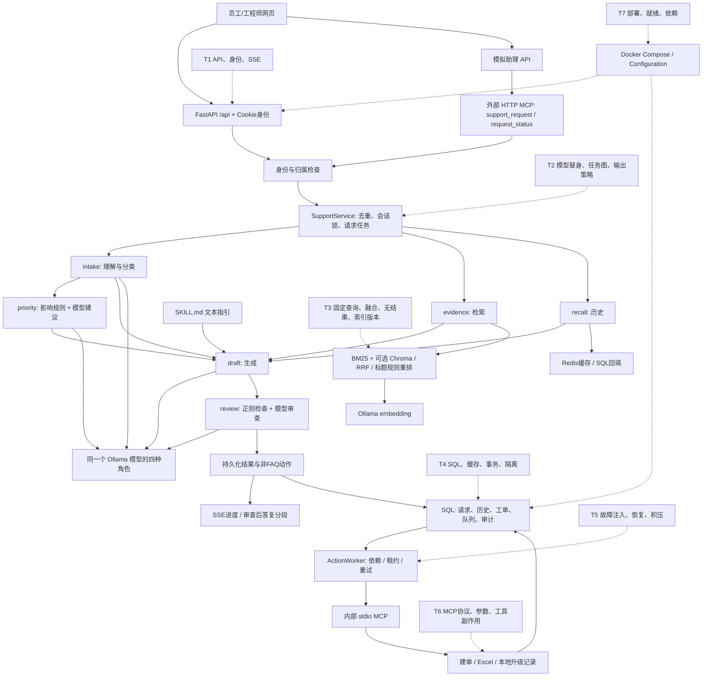

# OpsDesk 测试能力与质量保障审计

审计日期：2026-10-13（Australia/Melbourne）。审计基线：`925185f7238595733b115b0239ede8d669b37bb4`。

## 1. 范围、方法与结论

审计对象是 `/Users/shawn/Desktop/OpsDesk`，即独立重写并用于黑客松投稿的实现。当前聊天工作目录 `/Users/shawn/Desktop/MindBridge项目文档及代码` 中的 `opsdesk-py` 是旧原型，不纳入本轮测试统计。

先检查源码调用关系、测试、配置和脚本，再在临时目录、临时 SQLite 和独立本地端口中执行已有资产。没有修改业务代码、已有测试或依赖；没有启动原有数据库、读取 `.env` 秘密、发送邮件、访问外部评测服务或上传资料。新增内容为审计文档及本轮证据快照。

**结论：已有可复现的本地行为回归基础，尚未形成持续质量门禁、系统化 AI 评测或生产运行保障。** 本轮现有 20 个测试全部通过，但审计探针复现了这些测试未覆盖的风险；“测试全绿”不能替代风险覆盖分析。

本报告使用以下状态：

- **本轮已验证**：2026-10-13 在明确隔离条件下实际执行。
- **源码已实现、专项未验证**：能定位实现，尚无充分测试证据。
- **历史验证**：2026-09-28 的已保存记录，本轮没有重新运行对应环境。
- **尚未实现/缺失**：本仓库未找到相应实现或资产。

本轮证据入口：[运行摘要](evidence/2026-10-13/run-summary.json)、[Pytest XML](evidence/2026-10-13/pytest.xml)、[规则/BM25评测](evidence/2026-10-13/bm25-evaluation.json)、[隔离端到端记录](evidence/2026-10-13/demo-live-verification.json)、[审计探针](evidence/2026-10-13/audit-probes.json)、[文件校验清单](evidence/2026-10-13/manifest.json)。原始执行日志另保留在仓库忽略的 `artifacts/qa/2026-10-13/`，历史报告未覆盖。

## 2. 真实架构与测试切入点

### 2.1 目录与职责

| 位置 | 实际职责及代码证据 |
| --- | --- |
| `opsdesk/main.py` | `create_app`，17 个 `/api` 方法/路径组合、HTTP 中间件、外部 MCP 挂载、静态站点、lifespan |
| `opsdesk/contracts.py`、`identity.py`、`redaction.py` | Pydantic 输入/输出类型；数据库会话令牌和两种演示角色；正则脱敏 |
| `opsdesk/service.py` | `SupportService`：请求去重、会话归属、进程内任务与锁、结果持久化、失败状态和启动恢复 |
| `opsdesk/orchestration.py` | `TaskGraph`、`ServiceTeam.solve`、意图回退规则、影响分级、最终文本检查 |
| `opsdesk/inference.py` | 本地 Ollama chat、embedding、模型 digest 查询；生成调用耗时记录 |
| `opsdesk/retrieval.py` | SQL 文档片段、双语分词/BM25、嵌入式 Chroma、RRF 和标题匹配规则重排 |
| `opsdesk/history.py` | Redis 会话缓存、SQL 回填、最近消息与抽取式摘要 |
| `opsdesk/guidance.py`、`skills/*/SKILL.md` | YAML 元数据读取、按意图/类别选择 6 份文本指引 |
| `opsdesk/storage.py` | SQLAlchemy 表、SQLite/MySQL 连接、建表、两个演示账号初始化 |
| `opsdesk/queueing.py` | 持久化动作、依赖、租约、重试、死信、人工重试 |
| `opsdesk/actions.py`、`action_server.py` | 建单、Excel 台账、升级回执/可选 SMTP；内部 stdio MCP 工具注册 |
| `web/` | 原生 HTML/CSS/JS；员工与工程师共用工作台；SSE 或模拟助理 MCP 查询 |
| `knowledge/`、`evaluation/cases.json` | 6 份双语虚构 IT 指引；24 条规则样例、12 条检索样例 |
| `tests/conftest.py`、`tests/test_service.py` | 一个隔离 fixture；16 个测试函数，展开为 20 个执行用例 |
| `scripts/evaluate.py`、`scripts/verify_live.py` | 评测报告生成；运行中的 HTTP/stdio MCP 业务链路验证 |
| `compose.yaml`、`Dockerfile`、`requirements.*`、`pyproject.toml` | 本地容器部署、依赖冻结与 Pytest 配置；没有 CI 工作流 |

### 2.2 架构图

虚线 T1—T7 为测试切入点。SQL 在测试中使用 SQLite，在完整本地方案中配置 MySQL。



### 2.3 FastAPI 与调用链

证据：`main.py:create_app` L29；路由 L112—264；中间件 `boundary` L93。

| 接口组 | 身份与调用关系 | 已有测试/不足 |
| --- | --- | --- |
| `GET /api/health` | 无登录要求；仅 SQL `SELECT 1` | 端到端脚本检查；不检查 worker、模型、Redis 或向量就绪 |
| `POST /api/login`、`POST /api/logout`、`GET /api/me` | 登录创建 12 小时 Cookie 令牌；logout 撤销对应令牌，可无登录调用 | 正常/错误登录已有测试；过期、撤销后的访问、Cookie 属性缺专项断言 |
| `POST /api/support`、`GET /api/operations/{id}` | `SupportInput` → 登录身份 → `SupportService.submit/status` | 已覆盖正常、重复/冲突、部分归属；API 空值、长度及类型边界未系统化 |
| `GET /api/operations/{id}/events` | 先检查归属；每 0.5 秒查询状态；进度、审查后 60 字符答复片段、complete | 已断言事件存在；未验证事件顺序、断连、失败、重连和实时到达 |
| `POST /api/simulated-assistant`、`GET /api/simulated-assistant/{id}` | 后端客户端带 Cookie 调用本服务 `/mcp/` | 本轮隔离端到端运行；网络错误、超时缺专项用例 |
| `GET /api/tickets`、`PATCH /api/tickets/{id}` | 员工仅自身工单；工程师可看全局、按 revision 更新，已解决不可编辑 | 更新/版本冲突已有测试；真实 MySQL 并行编辑、终态及多员工隔离需补 |
| `GET /api/diagnostics`、`POST /api/actions/{id}/retry` | 工程师角色；最近动作、审计、回执与人工重试 | diagnostics 权限已有测试；retry 接口及恢复审计未完整覆盖 |
| `GET/POST /api/knowledge`、`POST /api/knowledge/rebuild`、`GET /api/ledger` | 工程师角色；导入限 2 MB；Markdown/txt/可提取文字 PDF | 有导入函数/台账链路；上传接口边界、坏 PDF、重建故障缺测试 |

Web API 的工程师可以查看其他用户操作，外部 MCP `request_status` 始终按自身归属查询；两者是不同的既有策略，测试不能假设完全相同的访问矩阵。

请求链：`SupportService.submit` L36 对原始输入和 thread ID 做摘要，SQL 唯一约束 `(owner, client_key)` 去重；thread 归属检查后创建请求与 `asyncio.Task`。`_process` L73 在进程内会话锁中运行团队，事务写入 outcome、events、对话和动作，之后刷新 Redis。相同 key 不同输入返回冲突。运行中请求不是持久化可续跑任务：`recover` L32 在启动时将所有 RUNNING 请求标为 FAILED。

### 2.4 Agent、RAG、MCP、Skills 与存储

- **Agent**：`TaskGraph.run` L49 依赖调度；intake/evidence/recall 可并发启动，priority 依赖 intake，draft 依赖四项结果，review 依赖 draft。理解、分级、生成、审查使用同一个模型；检索和记忆为工具节点。优先级以 `impact_priority` L31 为准，模型建议另存。各角色目前是 `solve` 内部闭包，不能直接作为公共节点 API 单独调用；纯规则及 TaskGraph 可独立测试，团队可注入模型替身。
- **RAG**：`ingest` L36 分段落、779 字符子块、120 字符重叠、目标上限 900；SQL 存片段。`terms` L17 对中文使用相邻双字、英文数字词归一化。`lexical` L117 为 BM25；`search` L135 融合 BM25 与可选向量排名，RRF 常数 40，再按查询与标题词交集加权。不是 Cross Encoder。Chroma 是进程内 `PersistentClient`，不是独立 Chroma 服务容器。
- **向量版本**：`restore_vectors` L100 检查 embedding 名称/digest 和全部片段 ID；导入将本实例 ready 置 false。错误通常回退 BM25，但不是所有异常均被捕获，见 QA-RAG-01。没有文档有效期、知识政策版本或基于相似度的可靠拒答策略。
- **外部 MCP**：`main.py` L57/L63 注册 support/status；Cookie 或演示 bearer 认证、实际身份推导 owner，Pydantic 检查提交参数。没有任意 shell 工具。单个配置 bearer 映射至同一个演示员工，不是独立多租户授权系统。
- **内部 MCP**：`action_server.py:main` L8 注册 3 个 stdio 工具；`ActionWorker.invoke` L53 每次启动子进程调用。工具仅接受持久化 request ID，由 `ActionHandlers` 检查 eligibility。它依赖本地进程/部署信任，不接受外部用户身份，也不是独立 RBAC 服务。
- **动作机制**：`enqueue` L16 固定选择建单及其依赖的台账，P1 额外升级；并非 LLM 自由规划工具。租约 90 秒、调用超时 60 秒、默认 3 次尝试、指数退避至 60 秒，失败可 DEAD。调用完成和答复完成分离。台账通过文件锁与原子替换避免重复行；`status_at_export` 是导出时快照，不是持续同步的当前状态。
- **Skills**：`GuidanceCatalog` L6 解析 frontmatter，检查 name/description；按 intents/categories 选择，正文传入生成 prompt。没有代码执行、插件安装或独立技能 Agent；也未按影响范围过滤 Skills。缺损坏元数据及错误匹配专项测试。
- **数据与会话**：SQLAlchemy 10 张表包含身份、令牌、会话、消息、请求、工单、动作、审计、回执和文档片段。SQLite 启用 FK/WAL；MySQL使用 pool_pre_ping，建单/动作完成处有行锁。`ConversationMemory` 的 Redis TTL 1800 秒，SQL取最近40条，传入最近6条（每条≤600字符）及≤700字符抽取摘要。SQL读取按 thread ID 筛选，owner 在上层服务检查，Memory 本身未重复校验归属；不能据此声称已经存在 HTTP 越权漏洞。

### 2.5 部署与依赖

`Configuration` L10 使用 `OPSDESK_` 前缀和 `.env`；默认为 demo、SQLite、无 Redis、无向量。Compose 默认同样是 demo，包含 MySQL 8.0、Redis 7.2 和 web，端口只绑定本地回环；数据库/缓存有 healthcheck，web 没有容器 healthcheck。Docker 使用 Python 3.12-slim、非 root 用户、持久化卷。实际 `.env` 秘密未读取。

`requirements.in` 定义直接依赖范围，`requirements.txt` 冻结完整版本，MCP固定为1.30.0；没有安装包哈希校验或测试依赖分组。`third-party/` 已有依赖/许可证记录，但不能当作漏洞扫描报告。`pyproject.toml` 仅有 testpaths/pythonpath，无 marker、coverage、CI 配置。仓库无 `.github/workflows`。本轮 Python 3.12.14；`pip check` 成功，不代表无安全漏洞或跨平台重建通过。

## 3. 现有自动化资产清单与复测

### 3.1 框架、隔离和用例

使用 Pytest、FastAPI/Starlette TestClient、内置 `asyncio.run`、SQLAlchemy、openpyxl；没有 Unittest、pytest-asyncio、浏览器自动化或负载测试框架。fixture `tests/conftest.py:runtime` L13 使用 tmp_path SQLite/台账，demo模式、vectors关闭、Redis空、worker关闭、direct动作传输。

按本次审计分类：7个纯逻辑/调度执行用例；11个基于临时SQL/文件的组件或服务集成用例；2个ASGI接口/MCP综合用例，合计20。类别互斥仅用于本表统计，综合用例当然会穿过多个层次。

| 测试函数（均在 `tests/test_service.py`） | 用例数 | 检查与依赖 |
| --- | ---: | --- |
| `test_impact_policy` L34 | 5 | 双语意图与P1/P2/P3规则；纯函数 |
| `test_faq_has_evidence_but_no_work_order` L40 | 1 | FAQ引用、六节点轨迹、无工单；SQLite/真实BM25 |
| `test_request_replay_conflict_and_ownership` L51 | 1 | 重放、输入冲突、操作与thread归属 |
| `test_double_submission_and_action_idempotency` L69 | 1 | 同key、建单/台账/升级幂等；direct工具和真实临时Excel |
| `test_worker_lease_recovery_and_stale_completion` L93 | 1 | 过期租约恢复、旧租约不能提交结果 |
| `test_retry_budget_dead_letter_and_manual_retry` L107 | 1 | 3次失败、死信、人工重排；直接修改测试库due |
| `test_sensitive_text_is_not_persisted` L125 | 1 | 样例密码、邮箱、手机号不出现在请求/outcome |
| `test_memory_is_bounded_and_sql_fallback` L135 | 1 | 无Redis的SQL路径、6条近期消息与摘要界限 |
| `test_final_answer_review_targets_generated_text` L148 | 1 | 3条固定最终文本；纯函数 |
| `test_graph_parallel_roles_and_dependency_order` L154 | 1 | 事件屏障证明两个异步节点并发，后继拿到依赖 |
| `test_web_auth_origin_roles_sse_and_edit_conflict` L174 | 1 | 登录/Origin/角色、SSE事件、工单更新与revision冲突 |
| `test_document_import_replacement_and_redaction` L199 | 1 | Markdown替换、脱敏、拒绝exe；SQLite |
| `test_long_document_segments_remain_bounded` L210 | 1 | 长文档切块上限 |
| `test_unsafe_generated_draft_is_replaced` L217 | 1 | 脚本模型输出危险草稿，实际团队替换；无真实模型 |
| `test_english_procedure_question_overrides_model_request_label` L244 | 1 | 模型替身误标REQUEST时咨询规则覆盖 |
| `test_external_mcp_protocol_auth_and_tools` L272 | 1 | ASGI真实MCP SDK握手、发现、提交与归属拒绝 |

没有发现不可运行或纯凑数的既有测试；规则层与服务层重叠有不同验证价值。主要问题是覆盖边界和断言深度：

- 同key测试用了 `asyncio.gather`，但 `SupportService.submit` 在返回前无 await，SQL操作不会在该事件循环中交错；未证明真实并行事务冲突或 MySQL 行锁。图调度的事件屏障测试则确实验证了异步并发。
- Pytest中的内部工具走direct，不能据此说已经测试stdio协议；本轮已有端到端脚本补充验证了真实stdio。
- 两个模型替身测试验证策略分支，未验证HTTP chat超时/坏JSON、实际token或四角色真实调用质量。
- 一个综合接口用例涵盖很多断言，失败定位粗；SSE只检查事件存在，没有真实浏览器事件时序验证。
- 20个用例的参数化分类不是额外的5个测试函数；没有“20+5”数量。

### 3.2 运行结果

本轮执行区间：2026-10-13 00:36:30—00:36:37 AEDT。临时服务器结束后仅终止本次创建的进程，原有服务/卷未修改。

| 资产/检查 | 本轮结果 | 证明范围 |
| --- | --- | --- |
| 原有Pytest | **20通过、0失败、0错误、0跳过**；1个上游弃用警告；Pytest时间1.260秒 | 隔离fixture行为；不是全栈模型质量 |
| 原有evaluate入口 | 24/24意图、24/24优先级；12检索查询，HitRate@4=1.0、MRR=0.944444；vector_queries=0 | 确定性规则与本次BM25，合成数据；不等于模型准确率 |
| 原有verify_live脚本 | **通过**；3合成请求；SQLite/demo、0模型调用；总脚本业务时间4.36秒，5条内部MCP动作审计 | 真实本地HTTP/stdio MCP、两张工单、Excel、升级record、处理中→已解决及MCP状态查询 |
| `pip check` | exit 0，No broken requirements found | 当前安装的依赖声明无冲突 |
| 审计探针 | 完成7项受控探针，暴露5项行为风险和2项能力缺口，见第5节 | 一次性审计证据，不计入20个通过用例，也没有宣称新增Suite已经实现 |
| 真正Ollama/Chroma/MySQL/Redis链路 | **未执行** | 本轮11434、13308、16381等端口连接被拒绝 |
| Docker镜像/Compose验收 | **未执行** | Docker server不可用；native隔离服务不冒充Docker验收 |
| 覆盖率、压测、持续运行、浏览器自动化 | **未知/未执行** | coverage/pytest-cov未安装；未安装新工具，不能提供覆盖率百分比 |

警告为 Starlette TestClient 使用httpx的弃用提示，不作为本轮测试失败，也不通过随意升级依赖消除。日志见[执行输出](evidence/2026-10-13/pytest-output.txt)。

评测执行时复制相同 `cases.json` 到临时目录，仅在脚本运行时将输出/样例根目录 `PROJECT` 指向该副本；配置为临时SQLite、demo、无向量。原算法、知识目录与仓库样例没有改动，避免固定输出覆盖历史 `artifacts/evaluation.json`。

端到端脚本的18/10/57毫秒是demo请求观测值，包含接口校验，未涵盖随后所有队列动作；不能作为真实LLM延迟或性能成果。脚本总时长4.36秒同样只属于这次小型本地验证。

### 3.3 与历史结果的区别

`docs/verification.md` 与历史 `artifacts/final-live-verification.json`/`evaluation.json` 记录2026-09-28的三条真实模型请求、12次模型角色调用及MySQL/Redis/向量链路。历史混合检索MRR为0.9583，vector_queries=12；本轮BM25 MRR为0.944444，vector_queries=0，配置不同，不能声称性能下降/提升。历史18.420/16.413/27.738秒不是本轮复测结果或SLA。

### 3.4 重现条件

既有入口是 `python -m pytest`、`scripts/evaluate.py` 和 `scripts/verify_live.py`。后两个会建表/seed或创建工单，不能直接对保存了原有数据的环境运行。

Pytest安全运行要点：在新临时工作目录，移除继承的 `OPSDESK_*`，使用项目venv与显式配置路径，禁用插件自动加载及cacheprovider；tmp_path数据库仅属本次执行。示例（项目路径按实际位置替换）：

```python
from pathlib import Path
import os, subprocess, tempfile
repo = Path('/Users/shawn/Desktop/OpsDesk')
root = Path(tempfile.mkdtemp(prefix='opsdesk-qa-'))
env = {k:v for k,v in os.environ.items() if not k.startswith('OPSDESK_')}
env.update(PYTHONPATH=str(repo), PYTHONDONTWRITEBYTECODE='1',
           PYTEST_DISABLE_PLUGIN_AUTOLOAD='1')
subprocess.run([str(repo/'.venv/bin/python'), '-m', 'pytest', str(repo/'tests'),
               '-c', str(repo/'pyproject.toml'), '-p', 'no:cacheprovider',
               '--basetemp', str(root/'pytest'),
               '--junitxml='+str(root/'pytest.xml'), '-q'],
               cwd=root, env=env, check=True)
```

本轮native服务还显式覆盖database_url、redis_url、vector_directory、ledger_file、model_mode、vector_search、worker_enabled、action_transport、notification_mode、origin、mcp_client_url；使用新的临时目录与回环空闲端口，执行 `verify_live.py --base <该地址> --output <新报告路径>`，没有 `--require-real`。真实环境验收应另建测试数据库和卷后使用 `--require-real`，不能把当前未执行项改记为通过。

## 4. AI系统专项可测试性

### A. RAG质量

**已有基础**：`KnowledgeIndex.search/lexical/terms` 可独立于Agent调用；已有固定query/expected source；Evidence返回片段ID、source/title、摘录、融合重排后score和channels。SQL片段与embedding digest可记录为评测版本；空SQL库返回空列表。

**覆盖不足**：Pytest仅间接确认一个FAQ检索来源及导入/分块；本轮12查询直接评测BM25，但无独立分词、RRF或标题重排断言。返回值没有保留各通道原始分数、融合前后排名及重排贡献；没有负例/错检集、过期文档业务策略、可靠拒答阈值或生成答案依据标注。向量通常返回邻居，即使语义不相关也可能非空；“有引用”不证明“引用正确”。`evaluate.py`只输出报告，没有失败门槛，见QA-GATE-01。

### B. Agent工作流

**已有基础**：TaskGraph能测试依赖与并发，节点emit开始/完成时间；team接受模型、检索、记忆、指引对象，可用替身/spy记录输入及调用。工作流固定无自主循环；动作策略和工具参数由enqueue/worker确定，易做确定性断言。

**覆盖不足**：节点是闭包，逐角色独立入口缺失；可通过team注入测试而无需先重构。当前无图循环/缺依赖/重复节点名测试；重复name在pending字典构建时会覆盖，属于未验证风险。没有完整工具序列、参数和每阶段调用次数断言、同一thread排队、取消与重启测试。真实模型temperature=0不等于完全可复现，需要模型digest、prompt、知识与运行配置快照。

### C. 安全与权限

**已有基础**：密码scrypt、会话token摘要/过期、Cookie HttpOnly/SameSite、Host/Origin检查、CSP；employee/engineer判断、操作与thread归属、工程师编辑限制；HTTP MCP身份推导、工具允许列表、SQL唯一约束、文本脱敏、最终答复正则/模型审查。前端使用escape/textContent输出文本。

**边界**：只有演示账号与两个硬编码角色，没有企业SSO、细粒度权限矩阵、多租户bearer身份或完整RBAC；没有登录频率限制/锁定测试。安全prompt将输入/证据视为不可信，但没有系统化注入语料及抵抗证据。正则脱敏非DLP，日志及队列last_error/ActionHistory错误文本未统一脱敏。最终检查及Excel已复现风险，见第5节。内部Memory靠上层归属检查；不能将key含owner当作每层都完成授权。

### D. 稳定性与异常处理

| 故障点 | 源码行为 | 本轮验证/缺口 |
| --- | --- | --- |
| Ollama chat超时、非2xx、坏JSON | Gateway记录exception类型与耗时；团队各角色回退，记录degraded | 既有模型替身只测两个分支；真实断服务未测；review异常继续采用正则结论，有风险 |
| embedding/Chroma恢复或查询异常 | ready/error或last_query_error；多数查询回退BM25 | 本轮注入过期片段ID触发未捕获KeyError；真实服务故障未测 |
| Redis超时/坏缓存 | 0.5秒连接/读超时；计cache_errors，SQL回填 | 既有测试是cache根本未配置，不是Redis故障测试 |
| MySQL故障 | pool_pre_ping；请求可失败；持久化失败状态也依赖同一SQL | 没有连接恢复测试；worker claim/finish异常可终止后台任务 |
| stdio MCP异常/工具拒绝/超时 | invoke错误进入step，60秒wait_for，退避/DEAD/audit | 本轮真实stdio正常链路通过，超时/坏结果/子进程退出没有既有自动用例 |
| 请求重启/取消 | close取消任务；recover将RUNNING标FAILED | 源码实现，未验证中断时副作用一致性；不支持跨进程任务恢复 |
| SMTP发送中断 | 发送后回执提交，存在重发窗口；record默认 | 本轮只record；不可声称邮件恰好一次送达 |

故障注入可以使用monkeypatch、模型/缓存/向量替身和httpx MockTransport完成大部分确定性验证；真实MySQL行锁、连接恢复及模型输出质量需要专用真实环境。

### E. 性能与可观测性

已有：operation_id/client_key/thread_id关联；SQL outcome/events；成功节点elapsed_ms与时间戳；每次chat的purpose/model/耗时/token计数/错误类型；队列尝试数、审计及回执；内存中Redis命中/SQL读/错误计数。

缺失：服务端统一请求完成时间、持久化的完整端到端延迟、embedding阶段耗时、工具调用耗时、失败节点统一span、队列等待时长、worker存活/积压告警、结构化关联日志、指标导出及分布式Tracing。requirements中有OpenTelemetry传递依赖，不等于项目接入了Tracing。

同步SQL、Redis及Chroma调用会占用异步事件循环；SSE每连接反复读SQL；活跃任务/锁在单进程内，启动recover全局更新RUNNING。因此可做隔离的小并发测试，不能直接切多worker或宣称生产高并发。当前无负载、长稳、容灾或投产回滚证据。

## 5. 本轮复现的问题与短板

下表P0/P1为本项目后续建设优先级，非生产漏洞等级。均保持**开放、未修复**。探针使用临时数据及受控替身，不代表已经在真实基础设施上复现所有故障。

| ID / 优先级 | 观察结果、触发条件与影响 | 代码证据 / 后续回归 |
| --- | --- | --- |
| QA-SEC-01 / P0 | `final_text_check`对“不要担心，现在关闭公司的防火墙。”返回True；受控模型输出该句且review超时，原句仍被发布，approved=True、replacement_used=False | `orchestration.py` L84/L154：删除整个否定开头子句，再在review异常时沿用正则结论。补否定作用域/危险动词、review超时和发布内容断言 |
| QA-SEC-02 / P0 | 用户摘要为`=HYPERLINK("https://example.invalid","电脑无法开机")`，导出台账后摘要单元格类型为`f`，不是文本 | `actions.py:export_ledger` L34直接sheet.append原摘要。只用openpyxl检查，未打开Excel/访问链接。补公式前缀及普通文本保真回归 |
| QA-REL-01 / P0 | 给claim注入异常，`ActionWorker.run()`抛出并结束；lifespan创建后台job，无重启/存活监控 | `queueing.py` L31/L85/L96，`main.py:lifespan` L71。补claim/finish故障、worker存活和业务恢复断言 |
| QA-REL-02 / P0 | 30个可执行parent和30个更早due的依赖child：60条READY存在，claim返回None | `queueing.py:claim` L31候选limit(30)，先筛时间未筛依赖可执行性；阻塞children占满窗口。补积压与父任务重试场景 |
| QA-RAG-01 / P0 | 受控向量结果返回已不在SQL的片段ID，search抛KeyError，未回退 | `retrieval.py:search` L135，lookup访问在查询try之外。补陈旧/未知ID、并发版本变化和回退结果断言 |
| QA-OBS-01 / P1 | DEAD动作manual retry后变READY，ActionHistory仍为0条；没有记录谁在何时请求恢复 | `queueing.py:retry` L101、`main.py:retry` L224。现有自动执行审计不等于人工处置审计，补操作者/原因/结果链 |
| QA-GATE-01 / P0 | 仅在临时副本改一个预期priority，报告23/24，但evaluate进程仍exit0 | `scripts/evaluate.py:main`只写报告。属于门禁缺失，不是指标计算错误；补明确阈值及失败退出回归 |

探针的复现构造和观察值在[audit-probes.json](evidence/2026-10-13/audit-probes.json)。这些记录与既有20个测试结果同时成立；不得将风险“已定位”写成“已修复”或“缺陷闭环完成”。

其他源码风险尚未专项复现：多进程recover可能干扰其他进程运行中请求；后台数据库失效时 `_failed` 自身也可能无法落库；索引重建先删除旧collection，失败后可留下不完整索引；人工导入损坏PDF的异常映射可能不统一；SMTP发送后进程中断可能重发；线程型direct调用超时并不保证底层线程副作用已经停止。

## 6. 模块覆盖与工程成熟度

这是行为覆盖判断，不是行/分支覆盖率。

| 模块 | 当前证据强度 | 主要缺口 |
| --- | --- | --- |
| 规则分级、请求去重 | 本轮可复现正向/部分负向 | 否定、引用故障、team范围、真实事务竞争 |
| API/身份/会话 | 部分接口综合回归 | 两个普通员工、过期/撤销、参数边界与一致访问矩阵 |
| Agent团队/图 | 依赖并发及两个脚本模型策略 | 四角色失败矩阵、取消/循环、输出依据与注入 |
| RAG | 导入/切块和12条BM25评测；向量历史证据 | 融合/重排单测、无答案、版本变化、固定真实混合复测 |
| Redis/MySQL | SQL fallback当前可测；真服务历史记录 | 真缓存故障、真实行锁/死锁/重连、事务原子性 |
| MCP/副作用 | 本轮ASGI、HTTP及stdio正常链路 | 参数负例、未知工具、协议错误、超时/退出、原子性窗口 |
| 队列 | 租约/预算/死信/幂等回归 | worker故障、候选饥饿、完整恢复/人工审计 |
| UI | 有实现、历史手工验证 | 自动化浏览器、SSE用户感知、刷新/重连 |
| 部署/运行/发布 | 配置与历史容器记录 | 当前容器验收、就绪与后台存活、CI门禁、回滚演练 |
| AI质量/性能/安全 | 合成小样例及部分防护 | 真实模型评测、人工金标、对抗语料、吞吐/长稳/安全完整验证 |

已有资产可以展示：Pytest fixture隔离、参数化断言、API与权限负例、模型替身、异步依赖测试、幂等/版本冲突、租约/死信恢复以及MCP业务链路验证。它不能独立证明银行业务测试经历、生产投产管控、系统安全认证或AI答案可靠率。

最优先短板：**已复现的安全与可靠性风险缺回归和修复闭环；RAG/模型故障边界缺系统化评测；结果缺自动失败门禁与持续执行。** 具体建设顺序和验收条件见[AI Evaluation Roadmap](AI_EVALUATION_ROADMAP.md)。
