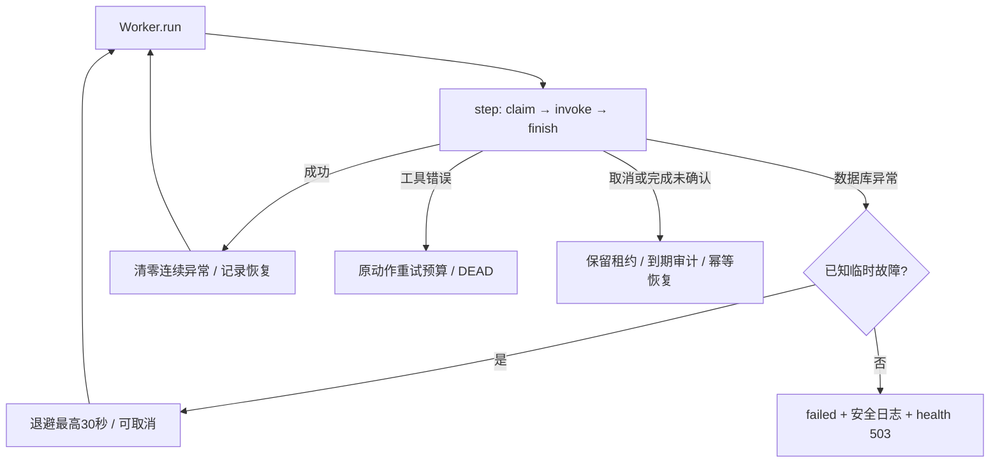

# OpsDesk Phase 2B：后台任务可靠性与故障恢复闭环

日期：2026-10-13（Australia/Melbourne）。项目：独立重写版 `/Users/shawn/Desktop/OpsDesk`。运行JSON采用UTC时间，因此显示2026-10-12，属于同一次本地2026-10-13工作。

## 1. 结论、范围与版本

**QA-REL-01、QA-REL-02 已在本报告声明的隔离场景内完成复现、根因定位、修复与回归。** 新增 **30 个 Pytest 执行用例**，完整 **109 通过、0 失败、0 错误、0 跳过，退出码 0**。包含原有 79 项（初始20项 + Phase 2A新增59项），这些测试、fixture、评测金标及历史审计记录均未修改。

实际业务修改仅为 `opsdesk/queueing.py` 和 `opsdesk/main.py`。使用现有 Pytest、SQLAlchemy、httpx、openpyxl、asyncio及标准库，没有新增依赖、队列系统、AI功能、CI或监控平台。没有操作真实业务库、既有数据库卷或外部生产系统。

| 版本 | Git提交 | 核对与用途 |
| --- | --- | --- |
| Phase 2A之前的HEAD | `925185f7238595733b115b0239ede8d669b37bb4` | 历史位置；本轮不能用它替代Phase 2A基线 |
| 冻结Phase 2A | `cc659a1131ba6a6d9d9066c58a9724a16347abba` | `test(qa): freeze verified Phase 2A defect closures and 79-case baseline`；先重跑79项通过，再显式提交已验证源码、测试、审计与历史证据 |
| Phase 2B修复及正式测试 | `6012e8898cc17eb20160bdb0321e12ad3206cbba` | `fix(queue): recover worker database faults and prevent dependency starvation`；仅2个业务文件和4个新增测试文件 |

开始时Git index为空。Phase 2A工作区文件与其已验证运行/manifest的哈希一致，原20项及gold与原HEAD一致；按明确文件清单提交，没有混入其他用户改动。冻结后工作区干净。Phase 2A报告中“未提交”是其生成时的历史事实，未被改写；本报告记录后续冻结提交。

历史Pytest失败日志/XML包含Git whitespace检查会指出的原始输出空白，保留字节原样。源代码检查通过；不能把保留日志中的空白说成代码检查失败或修改历史输出来隐藏它。[基线与哈希](evidence/phase2b-2026-10-13/baseline.json)、[完整性检查](evidence/phase2b-2026-10-13/integrity-check.json)、[版本记录](evidence/phase2b-2026-10-13/versions.json)、[源码与新增测试patch](evidence/phase2b-2026-10-13/changes.patch) 可追溯实际版本。没有push远程仓库。

## 2. Test → Fix → Regression：实际运行记录

完整阅读Phase 1审计、路线图和Phase 2A关闭报告，检查实际Worker、生命周期、SQL模型与动作副作用。先新增正式测试执行旧实现，再修改业务代码。测试开发中保留中间失败结果，不删除或弱化原79项断言。

| 运行 | 通过 / 失败 / 错误 / 跳过 | 退出码 | 证据 |
| --- | --- | ---: | --- |
| 修改前复查Phase 2A | 79 / 0 / 0 / 0 | 0 | [phase2a-recheck](evidence/phase2b-2026-10-13/phase2a-recheck/run-summary.json)；Pytest 7.413秒 |
| 首批30项 + 原79项，业务代码仍为Phase 2A | 90 / 19 / 0 / 0 | 1 | [before](evidence/phase2b-2026-10-13/before/run-summary.json)、[原始日志](evidence/phase2b-2026-10-13/before/pytest-output.txt) |
| 首轮局部修复 | 108 / 1 / 0 / 0 | 1 | [after-first](evidence/phase2b-2026-10-13/after-first/run-summary.json)；剩余失败来自测试未处理MCP/AnyIO的ExceptionGroup封装 |
| 冻结最终测试，对Phase 2A源码临时副本复现 | **90 / 19 / 0 / 0** | **1** | [before-verified XML](evidence/phase2b-2026-10-13/before-verified/pytest.xml)、[日志](evidence/phase2b-2026-10-13/before-verified/pytest-output.txt)、[JSON](evidence/phase2b-2026-10-13/before-verified/run-summary.json)；原79项全部通过 |
| 修复后针对性回归 | 30 / 0 / 0 / 0 | 0 | [targeted-after](evidence/phase2b-2026-10-13/targeted-after/run-summary.json)；Pytest 2.828秒 |
| 修复后完整回归、提交前 | 109 / 0 / 0 / 0 | 0 | [after](evidence/phase2b-2026-10-13/after/run-summary.json)；Pytest 10.337秒 |
| 修复提交后完整版本验证 | **109 / 0 / 0 / 0** | **0** | [after-commit JUnit](evidence/phase2b-2026-10-13/after-commit/pytest.xml)、[JSON](evidence/phase2b-2026-10-13/after-commit/run-summary.json)、[日志](evidence/phase2b-2026-10-13/after-commit/pytest-output.txt)；Pytest 10.530秒；源码与测试均匹配 `6012e88` |

最终红/绿对照的**测试文件与gold哈希完全一致**。红运行只在临时副本还原 `queueing.py`、`main.py` 为 `cc659a1` 的字节，保留Phase 2A其他修复。没有恢复到旧版项目，也没有在真实工作区回滚或修改金标。

19个失败是两项缺陷及其恢复/观察契约的失败断言，不是19个独立缺陷。其中永久错误用例的旧实现同样抛出，但没有需要的失败状态与安全日志，表现为缺少 `observations`。异常关闭测试改用 `except* ValueError` 解包SDK实际异常形状，只接受指定合成错误；仍严格断言Worker退出和数据库释放，其他异常不会被吞掉。随后用该最终测试重跑旧实现，确认依然因未清理Worker而失败。

### 隔离与口径

- Python 3.12.14；Pytest 9.1.1、SQLAlchemy 2.0.54、FastAPI 0.141.1、httpx 0.28.1、openpyxl 3.1.5、MCP 1.30.0、AnyIO 4.15.1、PyMySQL 1.2.3，见运行JSON。
- 每次从临时工作目录执行，移除继承的 `OPSDESK_*`，fixture `_env_file=None`；禁用第三方插件自动加载及Pytest缓存。数据库、Excel、锁文件、向量目录、评测输出均为隔离临时数据。
- SQL状态与工单/台账操作真实执行；模型、向量及数据库故障用受控替身。MySQL错误对象仅用于验证错误分类，**没有连接真实MySQL**。生命周期使用真实MCP session manager，但本轮可靠性用例调用工具走direct，未验收真实stdio subprocess故障恢复。
- 租约到期及动作重试时间由逻辑时钟推进；退避替身记录计划间隔并yield，没有实际等待30秒。不能据此宣称真实数据库恢复耗时或故障恢复SLA。
- 所有运行保留现有Starlette/httpx弃用警告。没有跳过失败测试、安装覆盖率工具或运行长稳/压力测试；覆盖率未知。测试执行秒数不是员工响应延迟。

## 3. QA-REL-01：Worker异常退出、完成写入与关闭恢复

### 原始表现与根因

1. [旧版快照](evidence/phase2b-2026-10-13/before-source/opsdesk/queueing.py) 的 `run()` 直接调用 `step()`；claim在try块外。数据库异常直接结束循环，没有区分可恢复错误与配置/代码错误。
2. `step()` 将 `finish(result)` 放在工具调用try块中。工具已成功但完成状态写入失败时，再调用 `finish(error)`，把数据库故障误当工具失败；修复前before-commit场景已产生1个工单，但任务READY/tries=1，审计为FAILED、没有台账。after-commit场景虽完成任务，异常被吞掉，缺少恢复记录。
3. `lifespan` 的 `yield` 后清理不在finally中；应用体异常时留下未结束Worker且未dispose数据库。后台task未公开归属/存活状态，fatal claim后health仍200。
4. direct调用直接 `await asyncio.to_thread(...)`。取消协程不会停止Python线程；旧实现在受控线程仍执行时就返回取消，可能在关闭/重启后留下继续写入的任务。

### 最小必要修复

- [retryable_database_error](../../opsdesk/queueing.py#L24)：按SQLAlchemy类型、连接失效标志和DBAPI错误码判定。SQLite BUSY/LOCKED（含扩展码）、MySQL连接/死锁/锁等待及连接池超时允许恢复；schema、认证、约束、编程及未知错误停止并要求处置，不从错误字符串猜测。
- [run](../../opsdesk/queueing.py#L145)：已知临时故障按 `0.4、0.8、1.6…最高30秒` 退避，再尝试真实step；成功访问队列后清零连续错误并计恢复次数。未知/永久错误置failed，安全记录异常类名并抛出。数据库重试不消耗尚未claim动作的尝试预算。
- 已知临时故障的探测会在Worker存活期间持续进行，**间隔有上限，累计次数没有硬性上限**。这是保持数据库恢复后自动处理能力的选择，不是无限快速重试。单动作默认3次的预算独立保留；退避期可取消退出。
- [step](../../opsdesk/queueing.py#L128)：只把invoke失败记录为工具FAILED；完成写入错误传播至run。提交前失败保留RUNNING租约，待90秒租约过期后按既有幂等动作重试；已提交后异常按数据库实际DONE状态继续，不再次执行已完成动作。
- [invoke](../../opsdesk/queueing.py#L81)：direct线程任务有明确归属并shield；取消时等该dispatch结束、取回异常，再传播取消。保留未完成租约供重启恢复，不提前释放仍可能执行副作用的任务。
- [lifespan](../../opsdesk/main.py#L75)：finally内取消并await自有Worker，关闭Service，再释放数据库；正常与异常关闭均执行清理。保存 `app.state.worker_task` 并通过done callback取回fatal异常，日志只写异常类型。
- [health](../../opsdesk/main.py#L136) 与 [diagnostics](../../opsdesk/main.py#L236)：提供enabled/alive、running/backoff/stopped/failed、连续异常、恢复次数及错误类型。开启Worker但task已结束时health返回503；engineer诊断可定位失败。worker关闭配置不被误报为故障。



### 正式测试与实际处理证据（18项）

[test_worker_recovery.py](../../tests/reliability/test_worker_recovery.py) 及 [提交后状态观测](evidence/phase2b-2026-10-13/after-commit/scenario-observations.json)：

| 场景 | 实际断言与结果 |
| --- | --- |
| busy / deadlock / disconnect / pool，claim前两次失败（4项） | 计划退避0.4/0.8；恢复后两个动作DONE、tries各1、1工单/1回执、2条DONE审计；Excel实际1行数据；recoveries=1 |
| 连续9次临时故障（1项） | 间隔至30/30秒封顶；故障解除后任务及真实副作用完成，不形成空转 |
| schema / auth / constraint / programming / unknown（5项） | claim仅调用1次、没有退避，failed及类型可定位；日志不含合成私密错误正文；队列READY/tries=0 |
| finish提交前、提交后连接异常（2项） | 均退避一次；提交前租约回收1次、建单重放reused=True，父tries=2；提交后父tries=1且不重放；两者最终均1工单/1回执，没有错误FAILED审计 |
| 退避期取消、异步工具取消（2项） | 自有task结束；待处理任务不被丢弃。运行中动作先保持RUNNING，租约有效期内不可重新领取，逻辑到期后恢复为DONE，旧租约finish被拒绝 |
| direct真实本地线程取消（1项） | 线程完成事件在取消返回前已触发；重启后的幂等调用不新增工单；最终1工单/1台账回执 |
| 正常、异常应用关闭（2项） | Worker finally触发、task结束、数据库dispose；测试自己也清理红运行残留任务 |
| fatal后台退出与新app恢复（1项） | 真实ASGI health 503、engineer诊断alive=False及OperationalError；新app生命周期处理原隔离库剩余任务为DONE，实际1工单/1回执 |

这里“恢复”验证到了数据库最终状态、审计及Excel输出，不只断言Worker对象存在。

## 4. QA-REL-02：候选窗口饥饿、依赖和重试预算

### 原始表现与根因

[原审计探针](evidence/2026-10-13/audit-probes.json) 记录60条READY却claim=None。旧claim先 `READY + due <= now + ORDER BY due + LIMIT 30`，再逐个读取parent判断。30个更早到期、父任务尚未DONE的child占满窗口，30个可执行parent永远进不来。依赖DEAD的清理也占候选窗口；READY但预算已耗尽的异常状态没有再次检查tries，可能领取第4次。

实际模型 [QueuedAction](../../opsdesk/storage.py#L79) 只有due和phase索引，没有任务优先级列。P1/P2/P3是业务分级，`enqueue()` 对P1增加通知动作；现有调度不是P1抢占调度。本轮保留到期时间顺序，并用id稳定同到期时间排序，没有发明新的优先级机制。

### 修复

[claim](../../opsdesk/queueing.py#L56)：

1. 过期RUNNING租约每轮最多回收30条；保留lease CAS、tries预算及LEASE_EXPIRED审计。
2. 将READY且到期、tries已耗尽的动作每轮最多30条转DEAD；将依赖DEAD的到期child另以独立30条窗口清理，不占可执行候选。
3. 用self outer join在SQL中筛选：READY、已到期、tries小于预算，且无依赖或parent为DONE，**然后才ORDER BY due/id并LIMIT 30**。阻塞child不会挤走可执行parent；不逐个child查询parent。
4. 领取保留条件UPDATE：id、READY、已到期、预算未耗尽；rowcount成功才授予90秒租约并递增tries。finish继续核对id/lease/RUNNING，拒绝旧租约覆盖。
5. 每轮清理和候选有界，没有增加全队列Python扫描循环；SELECT有LIMIT并不保证数据库内部不扫描大表，真实执行计划/索引优化仍待验证。

### 正式测试与任务/副作用一致性（12项）

[test_queue_scheduling.py](../../tests/reliability/test_queue_scheduling.py)：

- **原60任务场景**：30父任务due为当前时间−1秒，30依赖child为−10秒，真实临时SQLite。旧实现首次claim=None；修复后首次领取父任务，SQL spy记录 **5条语句**（测试上限8，防止逐parent查询退化）。依次运行60个动作全部DONE、tries各1，30工单、30回执、60条DONE审计。Excel31行含表头；重放建单及导出均reused=True，仍30条业务记录。
- **DEAD依赖积压**：30 DEAD父任务、60阻塞child、独立2动作。首次仍领取独立父任务；独立动作真实完成，有限清理轮后90 DEAD + 2 DONE，1工单/1回执。
- **依赖四种状态**：parent为READY且未来到期、RUNNING且租约有效、DONE、DEAD。只有DONE允许child执行；阻塞不会增加child尝试数，DEAD依赖准确传播。
- **空队列/未来到期**：均不领取，无副作用及预算消耗。
- **READY预算耗尽**：不再领取额外尝试，父/child均DEAD。
- **租约回收最后允许尝试/预算耗尽**：保留最大3次、LEASE_EXPIRED审计和旧lease fence，最终正确DONE或DEAD。
- **两个串行SQLite Worker**：领取不同root，错误lease不能finish；真实2工单/2回执，全部DONE。该测试不是并发事务/行锁验证。
- **工具连续失败→死信→人工依赖恢复**：默认3次失败及3条FAILED审计；先重试child被拒绝，父成功后child才可人工重试，最终1工单/1回执。没有借此实现人工操作者审计。

阻塞任务不能占候选窗口的性质来自SQL eligibility在LIMIT之前；60任务测试和DEAD积压测试给出具体可复现证据。不能从这个固定场景推导无限规模公平性或生产吞吐量。

## 5. 修改文件与证据组织

| 文件 | 内容 |
| --- | --- |
| `opsdesk/queueing.py` | DB异常分类、Worker退避/状态、完成写入边界、direct取消收尾、有界候选与依赖/预算筛选 |
| `opsdesk/main.py` | Worker自有task、异常finally清理、后台错误回收、health及诊断状态 |
| `tests/reliability/test_worker_recovery.py` | 18项故障注入、恢复、取消、重启、生命周期及存活验证 |
| `tests/reliability/test_queue_scheduling.py` | 12项60任务饥饿、依赖、到期、预算、租约、死信、副作用一致性验证 |
| `tests/reliability/helpers.py`、`conftest.py` | 合成请求、实际SQL快照、逻辑时钟、JUnit状态观测；复用原runtime fixture |
| `docs/qa/evidence/phase2b-2026-10-13/run_pytest.py` | 可复跑的隔离入口，保留真实Pytest退出状态、JUnit、JSON、依赖版本及源码哈希 |
| 本报告与同级证据 | 基线、正式红/绿、中间结果、源码快照、patch、版本、缺陷/分组摘要、哈希manifest |

原20项及Phase 2A59项文件字节保持不变；历史Phase 1/2A报告和证据没有改写。新runner单独放置，不修改Phase 2A runner。

### 安全复跑（从项目目录）

```bash
.venv/bin/python docs/qa/evidence/phase2b-2026-10-13/run_pytest.py --output /tmp/opsdesk-phase2b-rerun-NEW
.venv/bin/python docs/qa/evidence/phase2b-2026-10-13/run_pytest.py --suite reliability --output /tmp/opsdesk-phase2b-targeted-NEW
.venv/bin/python docs/qa/evidence/phase2b-2026-10-13/run_pytest.py --baseline --output /tmp/opsdesk-phase2b-red-NEW
```

每次用不存在或尚无JUnit的新输出目录；runner拒绝覆盖已保存JUnit。完整/针对性绿运行应exit0；baseline模式应exit1且90通过/19失败，不把它解释成测试工具失败或通过结果。最终输出：[缺陷JSON](evidence/phase2b-2026-10-13/defect-closure.json)、[Suite比较](evidence/phase2b-2026-10-13/suite-comparison.json)、[manifest](evidence/phase2b-2026-10-13/manifest.json)。报告发布前校验这些JSON/XML与文件哈希一致。

## 6. 已完成、残余风险与未验证范围

**完成**：两项可靠性缺陷的正式离线闭环、30项新增测试、原79项保持通过、两次完整绿回归（含提交后版本验证）、真实临时SQL/Excel状态与副作用断言、最小后台存活状态、安全异常日志、自有task取消收尾、版本与证据归档。

**仍需真实环境验证 / 尚未实现：**

1. **MySQL并发与事务**：本轮未连接MySQL/Redis。死锁/断连错误对象不代表真实断库恢复；条件UPDATE、依赖清理和手工重试间的竞态、隔离级别、行锁、唯一约束及租约回收需专用MySQL双连接测试。继续遵守现有单进程原型部署边界。
2. **关闭硬时限**：Python无法安全杀死线程。direct取消会等待dispatch结束，防止后台写入失去归属；如果文件锁/驱动永久阻塞，shutdown或60秒工具timeout仍可能等待超过名义时限。未解决强制终止、SIGKILL、进程隔离或任意挂死线程。
3. **租约与副作用**：没有增加租约续期。长期运行超过90秒、多个进程、崩溃窗口仍须真实验证。建单/台账的本地重放一致性已测，SMTP“发送成功但事务未提交”仍可能重复发送，不能宣称所有外部副作用exactly-once。
4. **MCP与运行依赖**：本轮可靠性测试为direct；未做stdio子进程超时/关闭/崩溃恢复、真实Ollama/Chroma、Docker重启/回滚、真实数据库停机演练。历史验收不作为该修复版本的验收证据。
5. **运行监控**：Worker观察仅为进程内字段与现有接口，没有持久化告警、指标平台、Tracing、积压/等待时间统计。health先查SQL；真实SQL不可用的结构化健康响应未在本轮完善。退避期alive=True不等于依赖全部健康。
6. **性能与公平性**：未运行压力/长稳测试、真实查询计划或延迟SLA。清理每轮最多30条，积压逐轮收敛；数据库表扫描成本、持续流量下公平性及抖动退避需求仍待测。
7. **QA-OBS-01仍开放**：人工retry不记操作者、原因、时间与结果链。本轮只验证依赖限制及恢复结果，没有新增该审计机制。
8. **覆盖率及AI质量**：覆盖率未知；未完成大规模API/权限矩阵、真实模型答案/引用质量评测或CI部署。109项离线通过不能说明所有代码分支、全语义安全或生产稳定性已验证。

### 与路线图对应及下一步

- `P0-1` 中QA-REL-01/02在声明场景关闭，结合Phase 2A完成五项原行为风险及QA-GATE-01，共6项有正式闭环；不宣称整份P0路线图完成。
- `P0-4` 已增补可靠性JUnit/JSON、隔离执行与状态证据；统一Suite入口、覆盖率和完整协议验收仍缺。
- `P1` 异常处置已具有最小Worker存活/错误状态，人工恢复审计和真实数据库/运行验收仍未完成。
- 后续优先：①为QA-OBS-01建立操作者/原因/动作关联/处置结果审计及回归；②专用MySQL双连接验证claim、finish、租约和提交不确定性，另测MCP子进程故障；③补小型API权限/失败矩阵及首次覆盖率基线。再决定运行告警与受控负载，不急于增加框架或AI功能。

## 7. 金融科技测试运营岗位：可真实使用的成果

这轮体现了测试资产与版本管理、数据库故障注入、异步生命周期测试、队列依赖及预算边界验证、租约fence、实际副作用幂等检查、根因定位与修复、JUnit/JSON工程证据和失败退出状态管理。项目仍是企业IT服务台本地原型，不能写成银行生产系统或线上运维经验。

**简历三条建议（结合Phase 2A）：**

- 基于Pytest构建OpsDesk AI服务台离线回归体系，覆盖输出审查、Excel安全导出、RAG异常降级、评估门禁及后台任务可靠性，109项用例全部通过；保留JUnit、JSON、版本哈希及修复前后证据。
- 通过故障注入定位并修复6项质量缺陷，形成复现—根因—修复—回归闭环；验证数据库异常退避恢复、取消/重启、租约回收、死信与重试预算，并以真实临时SQLite和Excel校验任务状态及副作用一致性。
- 复现并消除60任务依赖阻塞导致的候选饥饿，验证60个动作完成、30工单/30台账记录及重放去重；实现评估未达标/无法完成时的非零退出契约，为后续自动化质量门禁提供基础。

数字必须保留范围：109是Pytest执行用例（包含参数化），6是本地已闭环缺陷，60/30是合成隔离队列场景。不要写真实数据库可用率、响应提速百分比、恢复SLA、MySQL并发验收、生产exactly-once、完整监控/CI或模型准确率。桌面资源库同步报告供取用，当前改动没有远程发布。
